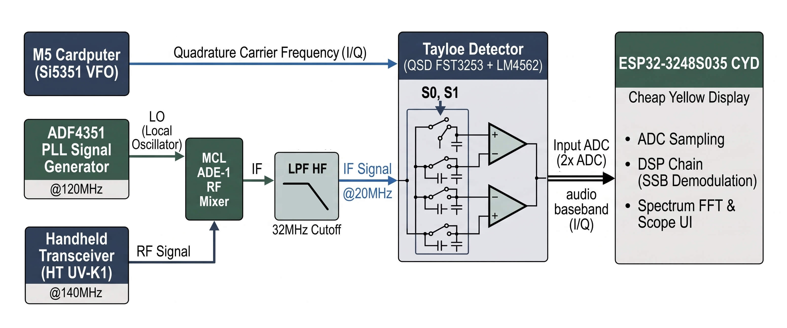
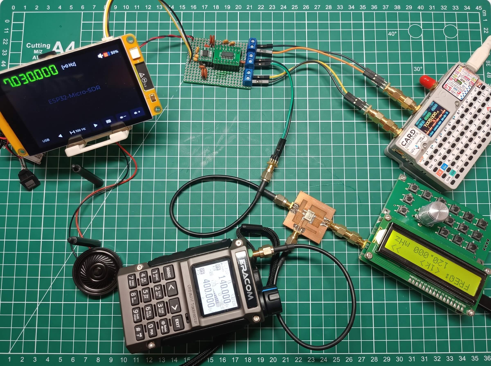
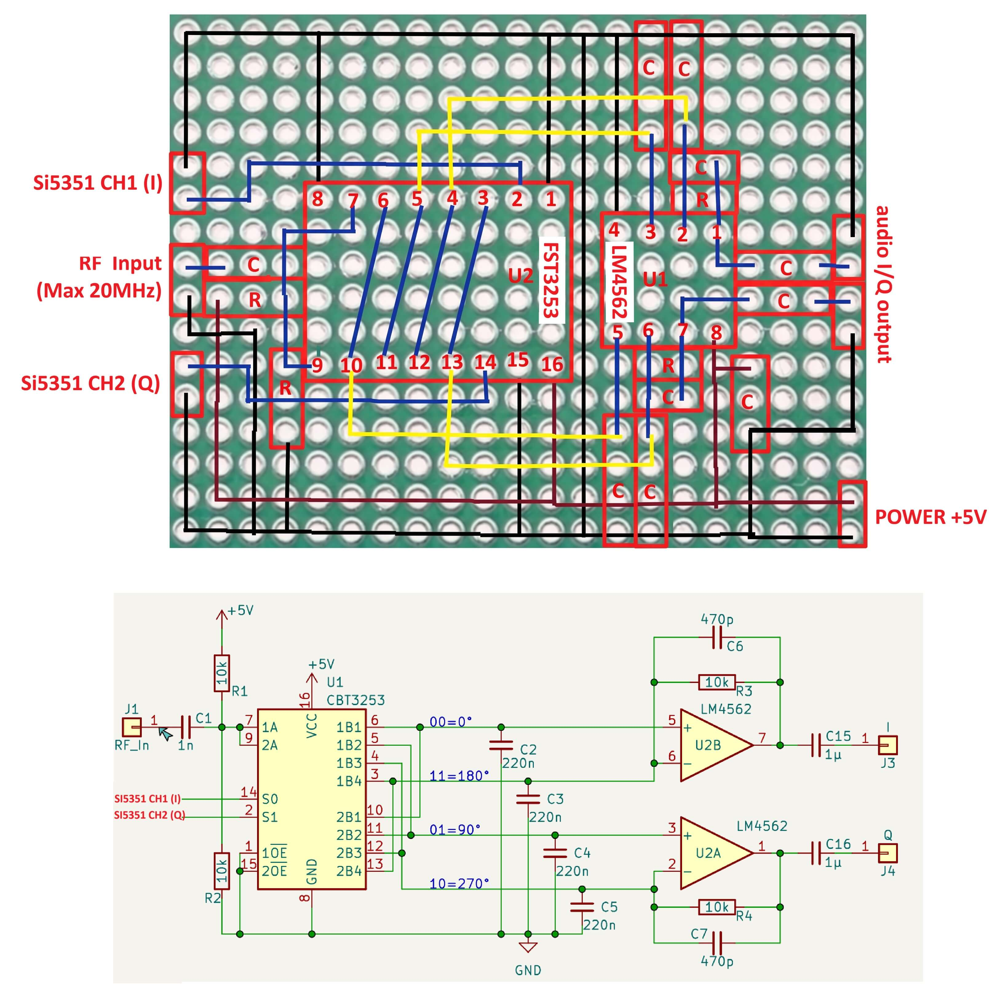
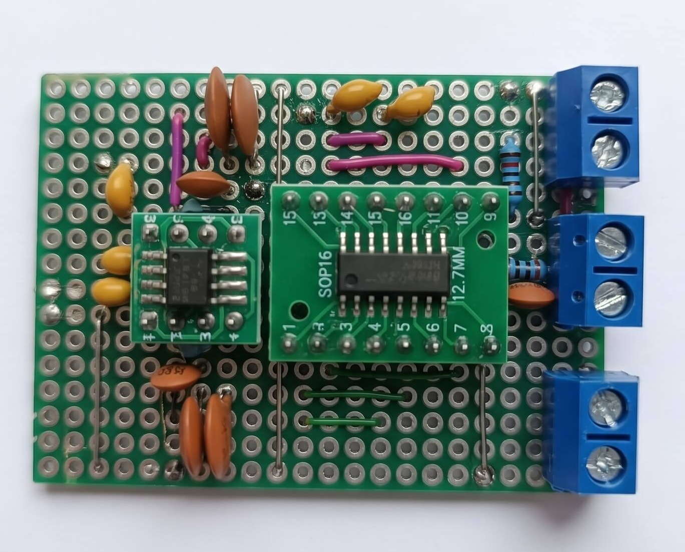

# ESP32-Micro-SDR

> Penerima SDR audio SSB di papan **ESP32-3248S035 CYD** (ESP32 WROOM-32,
> touchscreen ST7796 480×320 + GT911). Sinyal baseband I/Q datang dari
> **Tayloe detector** eksternal; firmware ini menangani sampling ADC,
> demodulasi SSB, dan komputasi FFT + UI spektrum/waterfall.

[](https://github.com/espressif/esp-idf)
[](https://www.espressif.com/en/products/modules/esp32)
[]()
[]()
[]()
[]()
[]()
[]()
[](LICENSE)
[]()

---

## Signal Chain




**Blok terkait:**

| Blok | Peran | Link |
| :--- | :--- | :--- |
| HT UV-K1 | Sumber sinyal HF yang di-down-sampling | — |
| MCL ADE-1 | Mixer down-sampling HF → baseband audio | — |
| M5 Cardputer Si5351 VFO | LO quadrature (90°) untuk Tayloe detector, dikontrol terpisah (I2C M5) | [repo](https://github.com/Muhammad-Yunus/M5Cardputer-Si5351-VFO) |
| Tayloe Detector (DIY) | Quadrature sampling detector berbasis FST3253, PCB Matrix | — |
| ESP32-Micro-SDR (repo ini) | ADC sampling, DSP chain, FFT, UI spektrum/waterfall + Settings runtime, audio out SDM | — |

---

## Fitur

- [x] ADC DMA I/Q 48 kHz/kanal (continuous, 12-bit, pool internal 8 KB)
- [x] DC block + NCO offset digital (LUT 1024 + interp linear)
- [x] Demodulasi SSB Weaver (USB/LSB, BFO 1500 Hz) @12 kHz pasca-decimation
- [x] Demodulasi AM (envelope detection |I+jQ|, DC-blocker envelope) — **mode default**
- [x] Default LO label `7 203 000 Hz` (Kconfig `CONFIG_SDR_DEFAULT_LO_HZ`)
- [x] AGC (attack 5 ms / release 200 ms, gain −36…+54 dB) + volume 0–100 %
- [x] Audio out sigma-delta 1-bit @10 MHz carrier (GPIO26 → FM8002A)
- [x] Spektrum: jendela Hann 1024 @12 kHz di-zero-pad ke FFT 2048 (5,86 Hz/bin),
      skala dBFS; mode bin **1024/2048** (11,72 / 5,86 Hz/bin) bisa diganti
      saat runtime
- [x] Line chart spektrum **span runtime ±250 Hz…±10 kHz** (efektif ≤ ±6 kHz =
      Nyquist), 1 bin/piksel (envelope max bila bin > piksel), marker puncak +
      chip frekuensi
- [x] Waterfall 480×60 RGB565 (fallback 44 baris), colormap 32 entri
- [x] Settings modal (ikon gear di top bar): mode FFT bin + span LO runtime
- [x] Drag horizontal waterfall = tuning NCO offset
- [x] UI LVGL 9.6: top bar (LO label + offset + volume + gear), bottom bar
      (mode, ±, step, keypad, volume)
- [x] **Self-test DSP on-target** (`CONFIG_SDR_SELFTEST=y`, default `n`): I/Q
      sintetis disuntikkan ke rantai DSP **tanpa ADC** (GPIO35/36 bebas),
       16 kasus uji (generator, DC removal, NCO, spektrum, demod USB/LSB/AM,
       volume, AGC, decimasi) dengan laporan PASS/WARN/FAIL di log serial

---

## Self-Test DSP (tanpa sinyal RF, tanpa ADC)

Build khusus untuk memverifikasi rantai DSP secara deterministik di board:

```bash
# firmware/sdkconfig.defaults → CONFIG_SDR_SELFTEST=y
idf.py build && idf.py -p <PORT> flash monitor
```

- `rx_adc_init()` **tidak** dipanggil → GPIO35/GPIO36 tidak tersentuh.
- Generator I/Q sintetis (`iq_gen`: tone/DC/noise ber-seed) disuntikkan ke
  rantai DSP produksi lewat `dsp_chain_process_block()`; PCM hasil demodulasi
  ditangkap `dsp_chain_set_pcm_sink()`.
- Laporan per kasus di log serial (tag `selftest`), contoh:
  ```
  I (3325) selftest: === RINGKASAN: 15 kasus -> 14 PASS, 1 WARN, 0 FAIL ===
  ```
- Setelah selesai pengujian firmware masuk **mode demo**: 2 tone sintetis
  mengalir ke spektrum/waterfall dan audio, sehingga UI tetap hidup tanpa RF.
- **Kembalikan ke build produksi** (`CONFIG_SDR_SELFTEST=n`) sebelum flashing
  ke board harian.

---

## Pengaturan Runtime (Settings modal)

Ikon **gear** di pojok kanan top bar membuka modal **Settings** dengan dua
kelompok kontrol yang langsung berlaku (tanpa restart):

| Kontrol | Nilai | Efek |
| :--- | :--- | :--- |
| **FFT bin** | 1024 / 2048 | Lebar bin keluaran spektrum 11,72 → 5,86 Hz/bin (RBW asli tetap 11,7 Hz). Mode 1024 memakai bin genap DFT-2048 — secara matematis identik dengan DFT-1024, tanpa inisialisasi FFT tambahan. |
| **LO span** | ±250 / ±500 / ±1k / ±2k / ±5k / ±10k Hz | Half-width tampilan spektrum & waterfall. Nilai efektif di-clamp ke FS/2 = 6 kHz (sampler 12 kHz): preset 10k tetap terpilih, readout menampilkan `±6K Hz (max)`. Default build: **±50 kHz** (kini di-clamp ke ±6 kHz saat boot). |

Perubahan skala juga memperbarui grid vertikal, label sumbu Hz, marker
puncak, dan **membersihkan waterfall** (baris lama memakai skala sebelumnya).
Semua state runtime disimpan di `sdr_config` (`sdr_config.fft_bins`,
`sdr_config.span_half_hz`) dengan critical section singkat.

---

## Harware Wiring & Schematics




---

## Dokumentasi

| File | Isi |
| :--- | :--- |
| [`docs/PRD.md`](docs/PRD.md) | Functional & Non-Functional Requirements |
| [`docs/ARCHITECTURE.md`](docs/ARCHITECTURE.md) | Struktur modul, task/core, antrean, aliran data, urutan init |
| [`docs/CONVENTIONS.md`](docs/CONVENTIONS.md) | Gaya kode C11, error handling, memori, Kconfig, git |
| [`docs/TECH_STACK.md`](docs/TECH_STACK.md) | Versi pustaka terverifikasi + daftar API yang boleh dipakai |
| [`AGENT.md`](AGENT.md) | Aturan wajib AI agent (PRD > ARCH > CONV > TECH) |

---

## Struktur

```
ESP32-Micro-SDR/
├── AGENT.md                     # Aturan AI agent
├── README.md
├── docs/
│   ├── PRD.md
│   ├── ARCHITECTURE.md
│   ├── CONVENTIONS.md
│   ├── TECH_STACK.md
│   └── hardware/
│       ├── testing_diagram.jpg
│       ├── testing_photo.jpg
│       ├── wiring_diagram_and_schematics.jpg
│       └── Tayloe_Detector_PCB_Matrix.jpg
└── firmware/
    ├── sdkconfig.defaults
    ├── main/
    │   ├── Kconfig.projbuild
    │   ├── app_main.c           # Init granular (tanpa bsp_init)
    │   ├── sdr_config.c/h       # Runtime config (NCO, LO label, volume, AGC,
    │   │                        #   mode FFT bin, span LO)
    │   ├── rx_adc.c/h           # ADC DMA I/Q (48 kHz, 12-bit)
    │   ├── dsp_chain.c/h        # DC block, NCO, LPF/decim, Weaver, AGC, audio out
    │   ├── spectrum.c/h         # FFT 2048 zero-pad (jendela 1024) + dBFS
    │   ├── audio_out.c/h        # SDM 1-bit GPIO26 + audio_feed_task
    │   ├── iq_gen.c/h           # Generator I/Q sintetis (build self-test)
    │   ├── selftest.c/h         # Suite uji DSP on-target (build self-test)
    │   └── ui/
    │       ├── ui_main.c/h      # Layout, keypad, tombol, Settings modal
    │       ├── ui_scope.c/h     # Spectrum line chart + waterfall + drag
    │       ├── ui_colors.c/h    # Palette + LUT colormap 32 entri
    │       └── font_dseg7_36.c  # Font 7-segmen DSEG7 (SIL OFL 1.1)
    ├── components/
    │   └── bsp_esp323248s035/   # BSP CYD (black box)
    └── managed_components/      # lvgl, esp-dsp (via registry)
```

---

## Build & Flash

```bash
# Prasyarat: ESP-IDF v6.1
cd firmware
idf.py build
idf.py -p <PORT> flash      # PORT = CH340 board, mis. COM10/COM12
idf.py -p <PORT> monitor    # log boot: heap, rate ADC, status DSP
```

> Port board bisa berubah enumerasi Windows (mis. COM3 → COM10 → COM12).
> Cek dengan Device Manager / `Get-PnpDevice -Class Ports` bila flash gagal
> "could not open port".

## Project Terkait

- [M5Cardputer-Si5351-VFO](https://github.com/Muhammad-Yunus/M5Cardputer-Si5351-VFO) — LO quadrature Si5351 untuk Tayloe detector
- [ESP32-3248S035-CYD-SDR](https://github.com/Muhammad-Yunus/ESP32-3248S035-CYD-SDR) — referensi awal & BSP CYD
